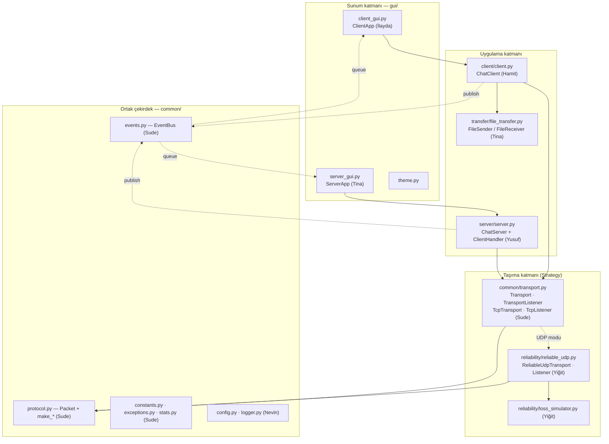
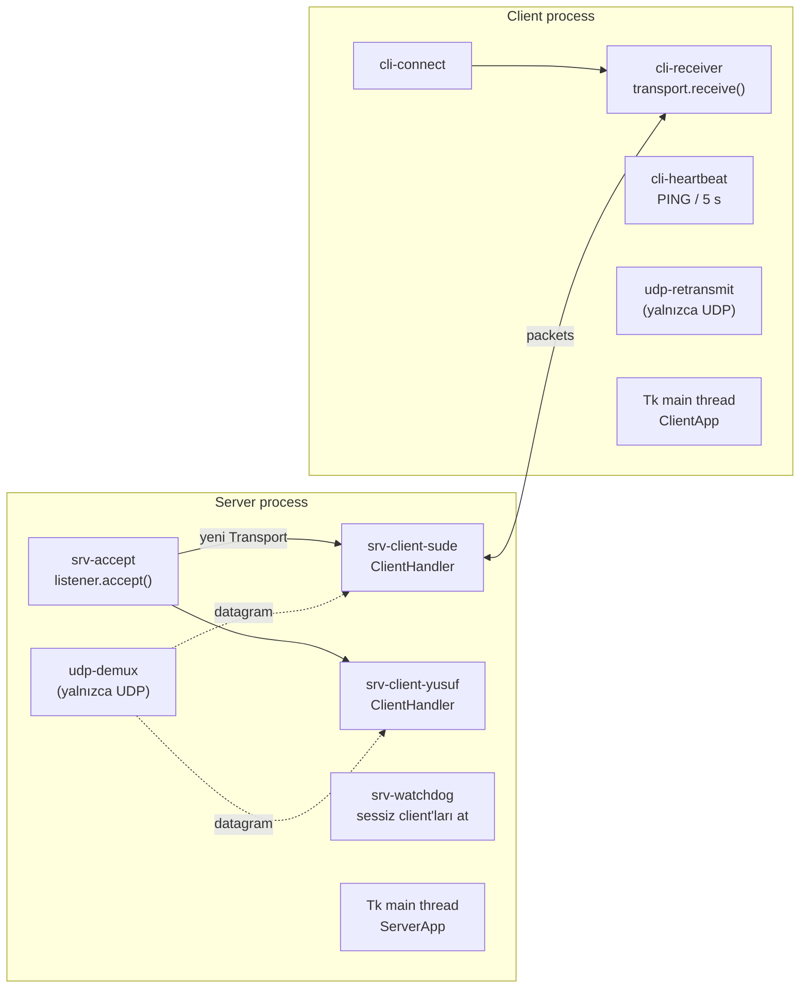
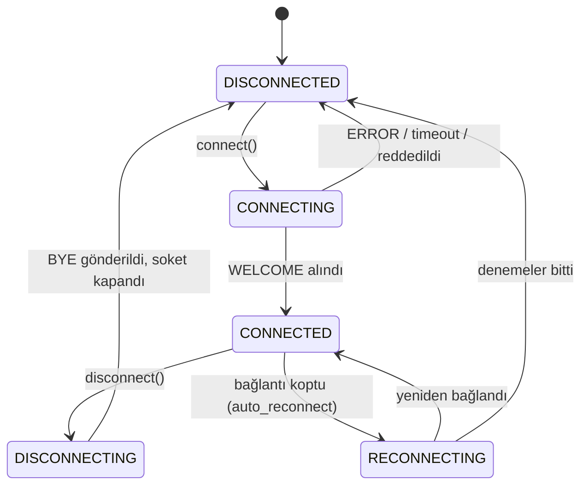
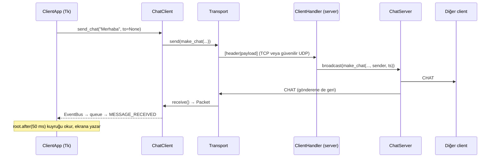
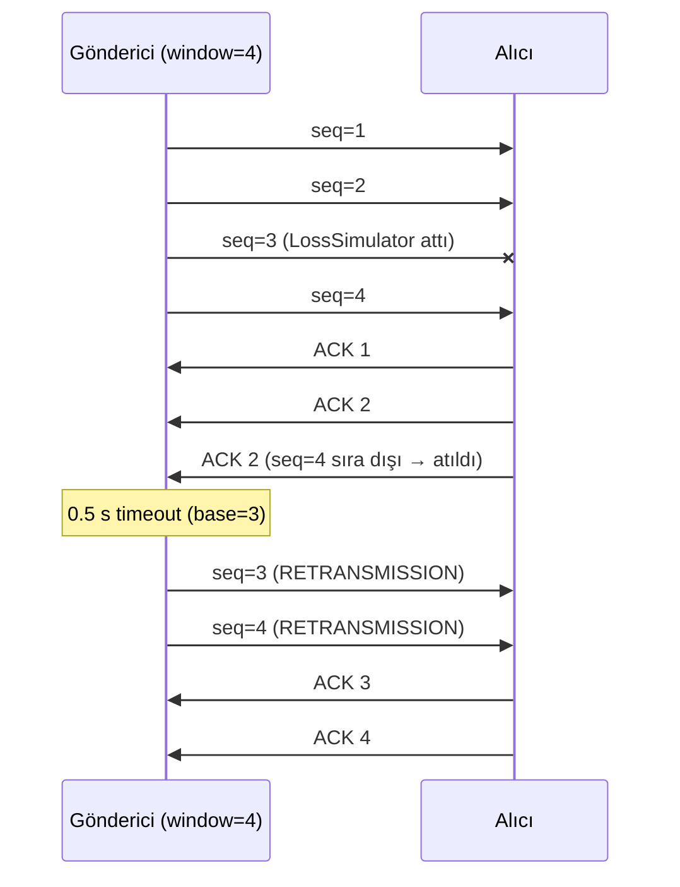

# SocketLink Mimari Dokümanı

> **Sahibi:** Sude · Bu dosyadaki diyagramlar GitHub'da otomatik çizilir (Mermaid). Rapordaki resmi diyagramları Nevin draw.io ile bunlardan türetir (`docs/diagrams/`).

---

## 1. Katmanlar

### 1.1 Import kuralları (döngüsel import ve çakışmayı önler)

| Modül | Import EDEBİLİR | Import EDEMEZ |
|---|---|---|
| `common/*` | yalnızca `common/*` ve standart kütüphane | `server`, `client`, `gui`, `transfer` (tek istisna: `transport.py` içindeki fabrika fonksiyonlarının **fonksiyon içinden** `reliability`'yi import etmesi) |
| `reliability/*` | `common/*` | `server`, `client`, `gui`, `transfer` |
| `transfer/*` | `common/*` | `server`, `client`, `gui` |
| `server/*`, `client/*` | `common/*`, `transfer/*` | `gui/*`, birbirleri |
| `gui/*` | hepsi | — |

**Altın kural:** `gui` dışındaki hiçbir dosya `tkinter` import etmez. Çekirdek kod GUI'den tamamen bağımsızdır ve terminalden/testlerden çalışabilir.

---

## 2. Tasarım desenleri (hocanın "design code pattern" şartı)

| Desen | Nerede | Neden | Raporda |
|---|---|---|---|
| **Strategy** | `Transport` arayüzü; `TcpTransport` ve `ReliableUdpTransport` | Sunucu/client kodu değişmeden TCP ↔ UDP geçişi | 3.6.13 |
| **Observer** | `EventBus` (`events.py`) | Ağ çekirdeği GUI'yi tanımadan olay yayınlar; GUI abone olur | 3.6.12, 3.6.13 |
| **State** | `ConnectionState` + `STATE_TRANSITIONS`, `ChatClient._set_state()` | Geçersiz durum geçişlerini engeller (ör. bağlı değilken mesaj göndermek) | 3.6.13 |
| **Factory Method** | `protocol.make_*()`, `create_transport()`, `create_listener()` | Paketler ve transport'lar tek yerden, tutarlı oluşturulur | 3.6.13 |
| **Thread-per-client** (eşzamanlılık deseni) | `ClientHandler(threading.Thread)` | Her client bağımsız; bir client yavaşsa diğerleri etkilenmez | 3.4, 3.11 |
| **Producer–Consumer** | `EventBus.subscribe_queue()` + `root.after()` | Network thread'leri üretir, GUI ana thread'i tüketir (Tkinter thread-safe değil) | 3.6.12 |

---

## 3. Thread modeli

Kurallar:
1. Bütün thread'ler `daemon=True` ve **isimli** (`name="srv-accept"` vb.). Log'larda `%(threadName)s` görünür.
2. Her döngü `while not self._stop_event.is_set():` ile döner; bloklayan çağrılar `SOCKET_TIMEOUT` (1 s) ile çağrılır ki durdurma isteği en geç 1 saniyede fark edilsin.
3. Paylaşılan her `dict`/`list` bir `threading.Lock` ile korunur. **Kilit tutulurken ağ üzerinden gönderim yapılmaz** (kopyala → bırak → gönder).
4. Aynı sokete birden fazla thread yazabiliyorsa `send()` içinde bir `_send_lock` kullanılır.
5. Network thread'i **asla** Tkinter widget'ına dokunmaz.

---

## 4. Client durum makinesi (State pattern)

GUI butonları duruma göre aktif/pasif olur: ör. `send_chat` yalnızca `CONNECTED` durumunda; Connect butonu yalnızca `DISCONNECTED` durumunda.

---

## 5. Bir mesajın yolculuğu (uçtan uca)

---

## 6. Güvenilir UDP — kayıp ve yeniden gönderim (rapor için alt diyagram adayı)

---

## 7. Genel API özeti (imzalar dondurulmuştur)

Bu imzalar iskelet dosyalarda tanımlıdır. **İsim, parametre sırası ve dönüş tipi değiştirilmez**; gerekirse önce sahibine ve Sude'ye danışılır, ardından bu tablo güncellenir.

### `ChatClient` (Hamit → İlayda kullanır)
| Metod | Döner | Sonuç olayı |
|---|---|---|
| `connect(config=None)` | `None` (hemen) | `CONNECTED` veya `ERROR` |
| `disconnect()` | `None` | `DISCONNECTED` |
| `send_chat(text, to=None)` | `None` | `MESSAGE_SENT`, sonra sunucudan `MESSAGE_RECEIVED` |
| `send_file(path, to)` | `int` transfer_id | `FILE_PROGRESS`… `FILE_COMPLETED`/`FILE_FAILED` |
| `get_stats()` | `dict` | — |
| `set_network_conditions(loss_rate, delay_ms)` | `None` | — |
| `state` (property) | `ConnectionState` | `STATE_CHANGED` |

### `ChatServer` (Yusuf → Tina kullanır)
| Metod | Döner | Sonuç olayı |
|---|---|---|
| `start()` | `None` | `SERVER_STARTED` |
| `stop()` | `None` | `SERVER_STOPPED` |
| `is_running` (property) | `bool` | — |
| `get_clients()` | `list[ClientInfo]` | — |
| `kick(username, reason)` | `None` | `CLIENT_LEFT` |
| `get_stats()` | `dict` | — |
| `set_network_conditions(loss_rate, delay_ms)` | `None` | — |

### `Transport` (Sude/Yiğit → Yusuf, Hamit, Tina kullanır)
`send(packet)`, `receive(timeout)`, `close()`, `peer_address`, `is_open`, `stats`, `set_network_conditions(loss_rate, delay_ms)`

### Olay veri sözleşmesi
Her olay tipinin `data` sözlüğünde bulunması zorunlu anahtarlar `common/events.py` içindeki `EVENT_DATA_KEYS` tablosundadır. Testler (`Event.validate()`) bunu kontrol eder.
